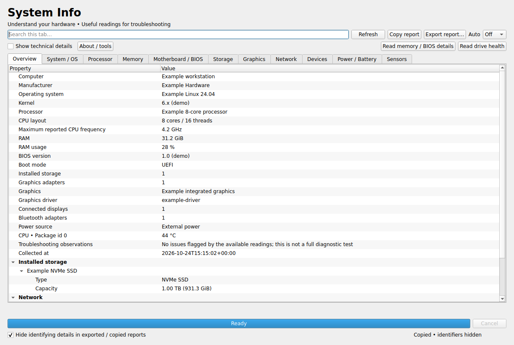

# System Info 1.4.0

A read-only Linux hardware information and troubleshooting utility. Explore your
processor, memory, motherboard/BIOS, drives, graphics, network, battery and sensors,
then copy or export a report. No account or upload is required.



*The screenshot uses illustrative test data, not a claimed reading from your computer.*

## Download and run an AppImage — start here

### 1. Download the application

Open [the latest release](https://github.com/edjenn1998/SystemInfo/releases/latest),
expand **Assets**, and download **`SystemInfo-1.4.0-x86_64.AppImage`**.
GitHub's “Source code” ZIP/tar downloads are for developers.

The AppImage includes Python, Qt, psutil and a Wi-Fi query fallback. It targets
**64-bit Intel/AMD Linux with glibc 2.35 or newer**, such as Ubuntu 22.04 and newer,
with a graphical desktop. It is not a Windows/macOS executable or an ARM/Raspberry
Pi or Alpine/musl build. The release includes its actual native ABI audit.

**Compatibility change:** version 1.3.0 uses a maintained Ubuntu 22.04 build
baseline. The older v1.2 executable had an audited minimum of glibc 2.30 and remains
in its original release, but does not contain these new fixes.

### 2. Allow it to run

An AppImage is a portable application file. You can keep it in Downloads or move
it into an `Applications` folder in your home directory.

On Ubuntu and many other Linux desktops:

1. Right-click the AppImage and choose **Properties**.
2. Open **Permissions** and enable **Allow executing file as program**. Other
   file managers may call this **Executable as Program**.
3. Close Properties and double-click it. Choose **Run** if prompted.

You do **not** need to install Python or run the app with `sudo`. The first launch
may take a moment. An application-menu entry is not installed automatically;
launch the same file again when you want to use it.

### Terminal alternative

Open a terminal in the download's folder (in Ubuntu Files, right-click the folder
background and choose **Open in Terminal**):

```sh
chmod +x ./SystemInfo-1.4.0-x86_64.AppImage
./SystemInfo-1.4.0-x86_64.AppImage
```

Use the actual filename you downloaded. `./` means “run this file in the current
folder.” If you see “No such file,” check the filename and terminal folder.

### If launching fails: no-FUSE mode

This release uses a modern, statically linked AppImage runtime. **You do not need
to install the older `libfuse2` or `libfuse2t64` package.** Normal launching uses
the kernel's FUSE mount facility. If your system restricts mounting, or you see a
FUSE or permission error, use the built-in no-FUSE launch mode:

```sh
./SystemInfo-1.4.0-x86_64.AppImage --appimage-extract-and-run
```

This extracts the app to a temporary folder, runs it and cleans up afterward.
Allow enough free temporary space. No FUSE package installation or administrator
access is required. If the download is on a filesystem that prohibits executable
files, move the AppImage to your home folder first.

For an extracted copy you can keep:

```sh
./SystemInfo-1.4.0-x86_64.AppImage --appimage-extract
./squashfs-root/AppRun
```

A message mentioning a newer `GLIBC` version means the distribution is too old for
this build; installing FUSE will not fix that. For other startup issues, run from
a terminal and include the error text and your Linux version in a
[GitHub issue](https://github.com/edjenn1998/SystemInfo/issues).

### Updates, removal and optional verification

Updates are manual: download the new AppImage, make it executable and use it in
place of the older file. Delete the AppImage to remove the application, plus any
`squashfs-root` folder you explicitly extracted. Reports you saved elsewhere remain
where you saved them. Preferences use `~/.config/edjenn1998/SystemInfo.conf` on Linux;
protected hardware inventories stay in memory for the current session only.

Optional: download `SHA256SUMS` beside the release files and verify integrity:

```sh
sha256sum --ignore-missing --check SHA256SUMS
```

The AppImage should report **OK**. This checks download integrity, not publisher identity.

## Using System Info

- **Overview** summarizes the computer, OS, CPU/core layout, RAM, drives, graphics,
  network, battery, useful temperatures and observations from available readings.
- Other tabs provide the detailed category inventories.
- **Search this tab…** filters the hierarchy while retaining matching parents.
- **Show technical details** reveals virtual devices, lower-level identifiers,
  extra records and unavailable fields. Reports include collected technical data
  even when the technical view is off.
- **Refresh** takes a new snapshot. **Auto** optionally refreshes every 5–60 seconds;
  it starts Off and never launches overlapping collections.
- **Cancel** stops normal collection at the next checkpoint and keeps the last
  complete report. Some operating-system/driver reads can delay stopping. Protected
  reads use their desktop authorization dialog to cancel; normal Cancel is disabled
  during those reads.
- **Copy report** copies a text report. **Export report…** saves JSON or text.
  Exports are written through a private temporary file and committed atomically,
  preserving an existing report if writing fails before replacement.
- **About / tools** lists the app/runtime versions and availability of optional
  inventory utilities. Missing tools and unexposed hardware data are normal on
  some machines; they do not imply a broken computer.

Refreshes preserve the active tab and expanded/collapsed groups. Window size and
technical-view preference are remembered. Export privacy starts enabled on each launch.

## Report privacy

**Hide identifying details in exported / copied reports** is enabled by default.
The same handling applies to JSON, text and copied reports: known serials, UUIDs,
user/host names, network addresses, SSIDs, filesystem labels, mount points and fstab
identifiers are hidden, including nested values and known copies in summary text.
The on-screen hardware view is not anonymized by this export checkbox.

Clear the checkbox only when you want those identifiers in your report. The CLI
also hides known identifiers by default; use `--include-identifiers` explicitly
when you need them. Export metadata records which mode was used. Missing values
remain missing rather than being presented as a hidden reading.

This is best-effort redaction, **not a guarantee of anonymity**: vendor/model and
other free-form text can still identify a machine. Review a report before sharing
it. fstab mount options are never collected because they may contain credentials;
URI credentials are scrubbed even in identifier-included exports. Files are not
uploaded anywhere by the application.

## Hardware interpretation

- CPU maximum clock is a driver-reported ceiling, including boost when exposed;
  it is not a promise of sustained/all-core speed.
- Memory bank counts describe firmware devices, possibly soldered chips, rather
  than proving user-upgradeable slots. Incomplete bank data is labeled as partial
  capacity; video-memory arrays are not counted as system RAM.
- The Memory tab retains the existing Qt/PySide6 interface and compact tree layout,
  grouped into **System Memory**, **Memory Configuration**, **Installed Modules**
  and **Swap**. Hover over capacity, speed and timing values for interpretation.
- **Installed RAM** sums populated system-memory SMBIOS devices only when the
  inventory is complete. **Usable RAM** is Linux `/proc/meminfo` `MemTotal`.
  **Unavailable to Linux** is installed minus usable, calculated before rounding.
  It can include firmware allocations, integrated GPU reservations, memory mapping
  exclusions and other system-level reservations, not only hardware reservations.
  Incomplete/unknown inventory or installed capacity below usable produces
  **Not available**, never a negative estimate. Known partial capacity is separate.
  Firmware can still be inaccurate even when internally consistent.
- Linux meminfo `kB` and SMBIOS `kB`/`MB`/`GB` denote binary units: 1024 bytes,
  1024² bytes and 1024³ bytes respectively. The UI displays GiB (1024³ bytes), not
  decimal GB (10⁹ bytes). RAM in use is usable minus available; available includes
  reclaimable caches. Older kernels without `MemAvailable` use psutil's estimate.
- Module details include technology, capacity, firmware slot designation,
  manufacturer, part number, configured transfer rate and rated speed where
  reported. Configured speed is a firmware report, not a live measurement. Rated
  speed is the firmware-reported module maximum, not the motherboard/controller
  maximum. MT/s is not MHz; legacy tool output retains its reported units.
- ECC capability requires both firmware array ECC reporting and extra module
  check-bit width. It does not establish that ECC is enabled. DDR5 on-die ECC is
  not evidence of system-level ECC. Unknown capability remains **Not available**.
  Channel mode is omitted: bank names, ranks and device counts do not prove it.
- **Active tCL/tRCD/tRP/tRAS and command rate show Not available.** Linux procfs,
  SMBIOS and standard EDAC interfaces do not provide a portable validated source
  for these active AMD/Intel timings. No controller register access, `/dev/mem`,
  I2C/SPD probing or vendor-specific tool is used. SPD/XMP/EXPO advertised profiles
  would not establish active settings. Firmware authorization does not unlock
  timings. Missing permissions and missing firmware fields are reported separately.

- Drive types use reported transport/rotation data; an unknown rotation flag is
  not assumed to be an SSD. Shared logical volumes are listed once, with additional
  parents noted. Remote filesystem space queries are skipped to avoid stalled
  network mounts blocking hardware collection.
- Graphics adapters and displays are separate. Preferred/supported modes are not
  mislabeled as current desktop resolution. Current resolution may be unavailable
  on some Wayland/compositor setups.
- Wi-Fi link rate describes the radio connection, not internet throughput. The
  access point's advertised rate is labeled separately from negotiated speed.
- Battery health is full capacity divided by original design capacity, not current
  charge. Available capacity/runtime can still be shown when design data is missing.
- Sensor names come from drivers; 0 RPM can be normal. No flagged observations
  means only that the available readings did not trigger these checks, not that a
  comprehensive diagnostic test passed.

Detection references: [Linux EDAC sysfs ABI](https://www.kernel.org/doc/Documentation/ABI/testing/sysfs-devices-edac)
documents module sizes/types, error modes and topology locations, but no standard
active timing attributes. [Linux procfs documentation](https://docs.kernel.org/filesystems/proc.html#meminfo)
defines the kernel memory accounting. Firmware decoding follows DMTF SMBIOS
types 16 (physical array) and 17 (memory device). EDAC fallback inventory is limited
and is never substituted for a complete SMBIOS installed-capacity measurement.

## Optional protected reads

### Memory / BIOS details

Click **Read memory / BIOS details** to request protected firmware inventory.
Your desktop authorization agent may ask for your administrator password. The
GUI remains unprivileged: it asks the system `pkexec` to run a trusted system `cat`
against the fixed `/sys/firmware/dmi/tables/DMI` path, then decodes SMBIOS in the app.
A trusted system `dmidecode` can be used as a fallback. No firmware is edited and
memory buses are not probed. Missing firmware fields cannot be manufactured by
granting permission. The inventory is cached only for the current session.

### Drive health

Click **Read drive health**, select a visible supported drive and authorize the
fixed read-only `smartctl -j -a` query. Install the system `smartmontools` package
if needed; on Ubuntu/Debian:

```sh
sudo apt install smartmontools
```

The app can show supported SMART status, temperature, hours, endurance/error
metrics and sector counts. A nonzero smartctl bitmask can still contain useful
health data. Some USB bridges, controllers and virtual machines do not expose it.
No self-test, repair or write command is run. Protected results are cached for the
session; use the button again to update them.

Both operations need `pkexec` and a working desktop polkit authorization agent.
They use trusted **system executables**, never an elevated bundled Python or iw.
System library paths are restored before invoking system tools. Collection and
saved-report export still work when protected access is unavailable or declined.

## Headless CLI

```sh
./SystemInfo-1.4.0-x86_64.AppImage --cli --list
./SystemInfo-1.4.0-x86_64.AppImage --cli overview
./SystemInfo-1.4.0-x86_64.AppImage --cli cpu memory --json
./SystemInfo-1.4.0-x86_64.AppImage --cli --json --output report.json
./SystemInfo-1.4.0-x86_64.AppImage --cli --json --include-identifiers
./SystemInfo-1.4.0-x86_64.AppImage --cli overview --sequential --progress
```

Add `--appimage-extract-and-run` before `--cli` if needed. With source, replace
the AppImage prefix with `python launch_system_info.py`. `--output` writes JSON
when `--json` is selected and text otherwise; choose an existing output folder.
Progress goes to stderr, keeping JSON stdout parseable. Ctrl+C cancels normal
collection; incomplete report files are discarded. CLI use does not request
protected desktop authorization.

## Source, tests and builds

Use **Python 3.12** for development/release builds; pinned Qt does not support
Python 3.14. On Ubuntu, source operation may need `python3.12-venv`, `libegl1`,
`libgl1`, `libxcb-cursor0` and `libxkbcommon-x11-0`. Ubuntu 22.04 does not provide
Python 3.12 by default; the AppImage is the simplest setup there.

```sh
python3.12 -m venv .venv
. .venv/bin/activate
python -m pip install -r requirements-dev.txt
python launch_system_info.py
QT_QPA_PLATFORM=offscreen python -m unittest discover -s tests -v
QT_QPA_PLATFORM=offscreen python launch_system_info.py --self-test
```

The suite has **111 tests**, including memory calculations, firmware edge cases and
offscreen UI regressions. Protected reads are checked with fixtures/mocks;
automated tests do not request administrator authorization. The packaged self-test
uses illustrative hardware data for deterministic GUI, search, icon and report
checks. Actual battery/firmware/drive permissions and driver support still need
verification on the target computer.

See [APPIMAGE.md](APPIMAGE.md) for pinned native/AppImage builds,
[AUDIT.md](AUDIT.md) for review findings, and [CHANGELOG.md](CHANGELOG.md) for changes.
GitHub Actions tests and builds on Ubuntu 22.04. Original code is **GPL-3.0**;
see [LICENSE](LICENSE) and [NOTICE.md](NOTICE.md) for current third-party notices.
The older compatibility manifests, vendor binaries and license archive describe
version 1.2 only; current notices and ABI/dependency records accompany each release.
